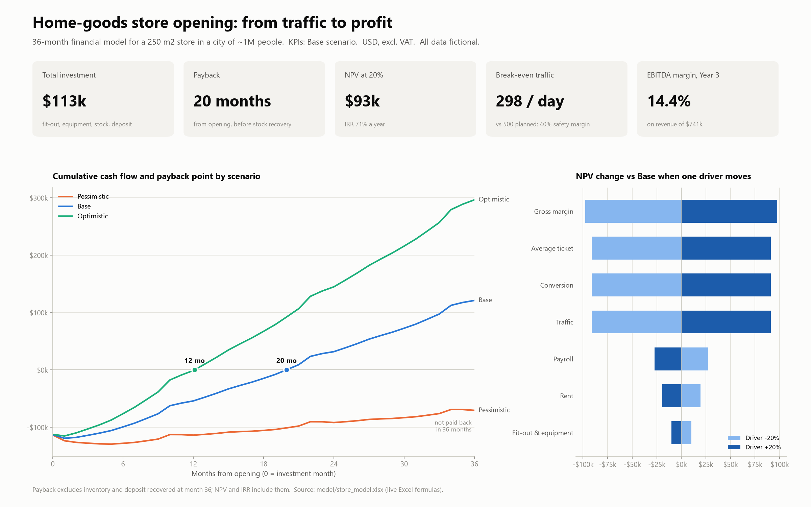

# Retail store opening: from traffic to profit

A 36-month financial model for opening a 250 m² home-goods store in a city of
about 1 million people. The model starts from foot traffic and works through
to profit, cash flow, payback, NPV and IRR. It comes with three scenarios, a
sensitivity analysis, Power BI-ready data and a one-page summary.

> **All numbers are fictional.** They are plausible assumptions for illustration
> and contain no data from any real company.



## Problem

A retailer is deciding whether to open a new store. The landlord wants a
signature, the owner wants to know three things:

- *How much cash do I need?*
- *When do I get it back?*
- *What has to go right for this to work?*

Spreadsheets that answer this are often hard-coded, one-scenario and impossible
to audit.

## Approach

1. **Driver-based monthly model.** Each month runs through the same chain:
   traffic × ramp-up × seasonality → receipts (× conversion) → revenue (× ticket) →
   gross profit → OPEX → EBITDA → income tax (losses carried forward) → free cash flow.
2. **Every assumption in one place.** The Inputs sheet holds every assumption
   in a yellow cell, with its unit and rationale. Formulas refer to named
   ranges (`Traffic_Plan`, `Tax_Rate`, ...), so they read like sentences.
3. **Three scenarios.** Pessimistic, Base and Optimistic values for five key
   drivers (traffic, conversion, average ticket, gross margin, rent). One
   switch selects the active scenario, and a live table compares all three.
4. **Sensitivity.** A tornado shows how NPV moves when one driver changes by
   ±10% or ±20%. A traffic × ticket grid shows payback for each combination.
   All results are live Excel formulas, with no macros and no pasted values.
5. **Integrity checks.** 18 automated checks with OK/ERROR status cover the P&L
   bridge, cash reconciliation, NPV cross-check and the absence of error values.
   The Base case was also re-computed independently in Python and matches to the cent.

## Key findings (Base scenario)

1. **The store pays back in about 20 months.** It needs $113k up front and
   $119k peak funding. NPV is **$93k** at a 20% discount rate and IRR is about
   71% a year. EBITDA margin settles at 14.4% by Year 3.
2. **Traffic is the deal-breaker.** Break-even is **298 visitors/day** against
   500 planned, a 40% margin of safety. In the Pessimistic case (430 visitors,
   23% conversion, $14 ticket, 36% margin) the safety margin shrinks to 13%.
   That store does **not pay back within 36 months**, and its NPV is −$52k.
   Validate footfall (counters, anchor tenants) before signing the lease.
3. **Margin and conversion matter more than rent.**
   - ±20% gross margin moves NPV by about **$97k**, roughly $13k per
     percentage point of margin.
   - ±20% traffic, conversion or ticket each move NPV by about $91k. A 10%
     lift in conversion is therefore worth as much as 10% more footfall, and
     it is usually cheaper to get.
   - ±20% rent moves NPV by only about $19k.

| Scenario | Revenue Y1 | EBITDA Y3 | NPV @20% | IRR | Payback |
|---|---:|---:|---:|---:|---:|
| Pessimistic | $458k | $24k | −$52k | −4% | > 36 months |
| **Base** | **$620k** | **$106k** | **$93k** | **71%** | **20.0 months** |
| Optimistic | $770k | $183k | $225k | 160% | 12.1 months |

## What the client gets

| Deliverable | File |
|---|---|
| Excel model with live formulas, 7 sheets (Inputs, Scenarios, Monthly, Summary, Sensitivity, Checks, Engine) | [`model/store_model.xlsx`](model/store_model.xlsx) |
| Power BI star schema: fact + 3 dimensions + sensitivity table | [`powerbi/*.csv`](powerbi/) |
| 10 documented DAX measures (Revenue, EBITDA %, Cumulative Cash Flow, Payback, NPV, Break-even Traffic, ...) | [`powerbi/measures.dax`](powerbi/measures.dax) |
| One-page dashboard spec with expected values for testing | [`powerbi/dashboard_spec.md`](powerbi/dashboard_spec.md) |
| One-page summary for the investment committee | [`images/summary.png`](images/summary.png), [`images/summary.pdf`](images/summary.pdf) |
| Reproducible Python build | [`src/`](src/), [`run_all.py`](run_all.py) |

## How to use the model

1. Open `model/store_model.xlsx` in Excel. LibreOffice Calc and Google Sheets also work.
2. On **Inputs**, change any **yellow** cell. Blue text marks typed values,
   black marks formulas and green marks links to other sheets.
3. Switch **Active scenario** (Inputs, General) between Pessimistic, Base and
   Optimistic. To change the scenario values themselves, edit the yellow cells
   on **Scenarios**.
4. Read the results on **Summary** (P&L by year, payback, NPV, IRR,
   break-even) and **Scenarios** (side-by-side comparison).
5. On **Sensitivity**, the shock sizes and the grid axes are also editable.
6. Check that **Model checks: OK** shows at the top of Inputs and Summary.
   Any ERROR is listed on the **Checks** sheet.

**Definitions used in the model:**
- **Payback.** The first month in which cumulative free cash flow turns
  positive, interpolated within that month and counted from opening. It
  excludes the stock and deposit recovered at month 36.
- **Break-even.** EBITDA = 0 for a mature store at Year-1 prices.
- **NPV.** Monthly cash flows discounted at the monthly equivalent of the 20%
  annual rate.

## How to rebuild

Requires Python 3.10+ and a spreadsheet engine to recalculate formulas.
Microsoft Excel on Windows is the tested engine. LibreOffice is used as a
fallback on macOS and Linux.

```bash
pip install -r requirements.txt
python run_all.py
```

`run_all.py` runs five steps:
1. Builds the workbook (`src/build_model.py`).
2. Recalculates it (`src/recalc.py`).
3. Verifies it: no `#REF!`/`#DIV/0!`, all checks OK, Base payback between 12
   and 30 months (`src/verify_model.py`).
4. Exports the Power BI tables for all three scenarios (`src/export_powerbi.py`).
5. Renders the one-pager (`src/make_summary.py`).

To change an assumption permanently, edit `src/assumptions.py` and rebuild.

```
├── model/store_model.xlsx    Excel model (live formulas)
├── powerbi/                  CSV star schema, DAX measures, dashboard spec
├── images/                   One-page summary (PNG, PDF)
├── src/                      Build, recalc, verify, export and chart scripts
├── run_all.py                One-command rebuild
└── requirements.txt
```

## License

[MIT](LICENSE)
